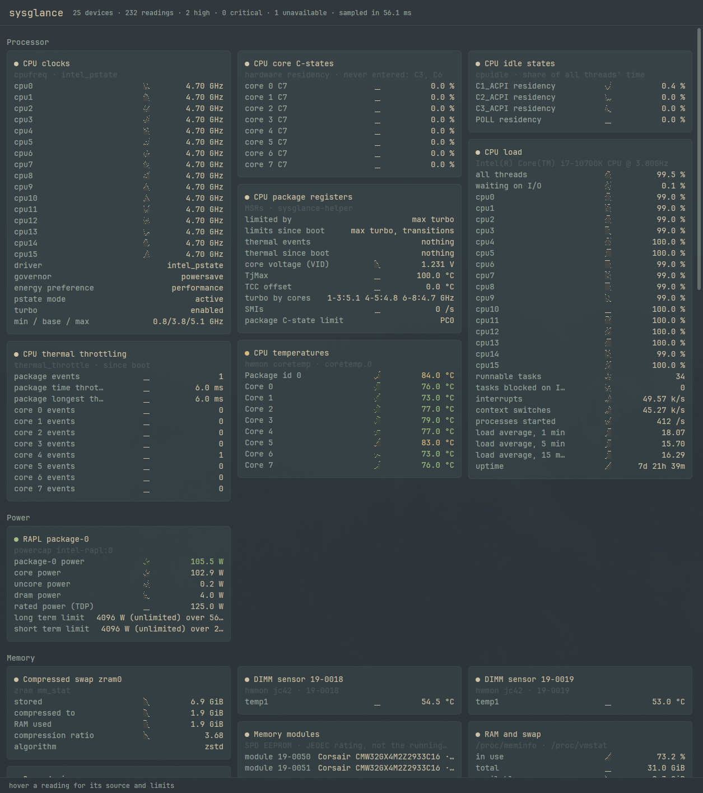

# sysglance

Every sensor and counter your Linux computer exposes, in one window, refreshed once a second.



sysglance reads what the kernel already publishes:

- **hwmon:** every chip (Super I/O, CPU, DIMMs, NVMe, SATA via `drivetemp`, GPU, Wi-Fi, laptop embedded controllers).
- **RAPL power** and its limits.
- **CPU:** load, clocks, idle states and throttle counters.
- **Memory:** RAM, swap, paging and zram.
- **Pressure stall** (PSI).
- **DIMM SPD** (DDR4).

With the optional helper it also reads:

- **CPU registers** (MSRs): what limits the clock, core voltage, TjMax, the turbo ladder, SMIs and hardware C-state residency.
- **SMART health** for every drive.

Each reading has a two-minute sparkline. A reading at or past its own driver's or drive's limit turns amber or red. A reading that can't be read says why, and hovering any row shows where it came from.

It runs on any Linux computer and shows whatever that computer has. It needs no configuration. Extra cards appear only where the hardware, the kernel or the helper provides them.

## Requirements

- Linux with a **Wayland** session. sysglance does not run under X11.
- A GPU with Vulkan or OpenGL ES (it renders with GPUI through wgpu).
- `libxkbcommon` at runtime.
- To build:
  - Rust 1.95 or newer;
  - a C compiler and `pkg-config`;
  - development files for xkbcommon, Wayland, fontconfig and freetype. The packages are:
    - Arch: `libxkbcommon wayland fontconfig freetype2`;
    - Debian/Ubuntu: `libxkbcommon-dev libwayland-dev libfontconfig-dev libfreetype-dev`;
    - Fedora: `libxkbcommon-devel wayland-devel fontconfig-devel freetype-devel`.

  These come from the build's `-sys` crates. Only the Arch build has been tested.
- Optional: `smartmontools` for SMART health.

## Install

```sh
git clone https://github.com/igouss/sysglance
cd sysglance
./install.sh
```

`install.sh` builds a release binary tuned for your CPU and installs it to `~/.local/bin/sysglance`, with a desktop entry. Then, if `sudo` is available and you are in an admin group (`wheel`, `sudo` or `admin`), it installs the privileged parts described below. It says what it did and what it skipped.

Run `./install.sh --user-only` to install only the window, with no root access at all. The privileged cards then say what they need.

To remove everything:

```sh
./uninstall.sh
```

## What the privileged parts do

Some readings are root-only. The window never runs as root; with your approval at install time:

- **`/usr/local/libexec/sysglance-helper`** is a small root-side reader, kept in its own crate that links nothing but the standard library and sysglance's pure core.
  - It takes no input.
  - It reads a fixed list of CPU registers through `/dev/cpu/N/msr` and never writes one.
  - It runs `smartctl --json=c -a -n standby` on each drive, so a sleeping disk stays asleep.
  - It prints text lines that the window decodes.
- **`/etc/sudoers.d/sysglance-helper`** lets your admin group run exactly that file, with no arguments and no password. The window starts it once with `sudo -n`. `install.sh` refuses to install the rule unless every directory on the helper's path is root-owned and not group- or world-writable.
- **`/etc/udev/rules.d/60-sysglance-rapl.rules`** makes the RAPL energy counters readable by your admin group.
  - **This re-opens the PLATYPUS power side channel (CVE-2020-8694) to every process run by members of that group.** The kernel made these counters root-only to close it.
  - Remove the rule (or install with `--user-only`) if that matters to you.
- **`/etc/modules-load.d/sysglance.conf`** loads `drivetemp` (SATA drive temperatures) and `msr` at boot, if your kernel has them.

## Supported hardware

- **Everything from sysfs and procfs** works on any architecture and vendor: hwmon, cpufreq, cpuidle, powercap, PSI and memory.
- **CPU registers** are decoded only on Intel Skylake-client cores: Skylake, Kaby Lake, Coffee Lake and Comet Lake desktop and mobile parts. Register meanings change between generations, so on any other CPU the card says *not supported* rather than guess.
- **DIMM SPD** is decoded for DDR4. DDR5 modules show *not supported*.
- **Motherboard voltages** are shown as the raw voltage at the sensor chip's pin. Boards scale some rails with resistor dividers (for example +12 V read through ×12), and that mapping differs per board.

## Theme

sysglance uses a dark theme. On [Omarchy](https://omarchy.org) it follows the current Omarchy theme and font, and recolours itself within a second of a theme change.

## Develop

```sh
git config core.hooksPath .githooks    # the pre-commit hook checks each commit as staged
scripts/check.sh                       # comments, Wayland-only dependencies, fmt, clippy, tests, hex-lint
cargo test -- --ignored                # tests against the live system: hwmon against `sensors -j`, installed Omarchy themes
sysglance --bench-scroll               # frame times while scrolling, and main-thread CPU per frame
```

`scripts/check.sh` skips `hex-lint` (a dependency-direction checker) when it isn't installed.

See [docs/design.md](docs/design.md) for how it is built, the invariants and the gate behind each, and the assumptions it makes.

## Licence

MIT or Apache-2.0, at your option. See [THIRD-PARTY.md](THIRD-PARTY.md) for the theme files used as test fixtures.
